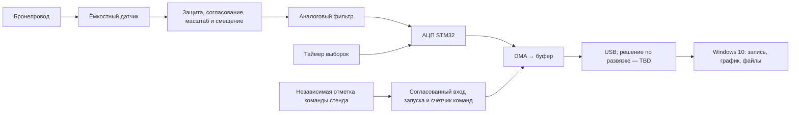

# Архитектура: предложение 0.3

Обновление 10.10.2026: MVP — один аналоговый канал на STM32F103C8T6 со встроенным АЦП и native USB FS, приложение Windows 10. Второй канал и автоматический анализ — после основы. Полный объём — в [mvp-spec.md](mvp-spec.md). Структура и численные примеры ещё не подтверждены измерениями. Сравнения других платформ ниже сохранены как расчёты для будущего развития.

## Измерение и ответственность узлов

DMA переносит отсчёты в память без обработки процессором каждой выборки. Прошивка отвечает за захват и передачу; ноутбук — за файлы, график, управление и справку. Стек Windows-приложения Dot выбирает в MVP-00 по совместимости и воспроизводимой упаковке; Python не является обязательным выбором. Питание, опорный потенциал и развязка — в [аппаратной части](hardware.md).

Будущий анализ предполагается на ноутбуке: признаки можно менять без перепрошивки, сохраняя MCU для измерения. В MVP обучение и диагностика не реализуются. Расширяемость обеспечивают разделение транспорта, записи и UI, версии протокола/файла, описание каналов и сохранение исходных данных; сложная система плагинов заранее не нужна.

Команда стенда позволяет записывать отсутствие отклика. Её фронт определяется по документации коммутатора. Индекс запуска привязывается к аппаратному времени, а не приходу USB-пакета; задержка и неопределённость проверяются. Индукционный датчик для двигателя — альтернативный, не параллельно соединённый источник запуска.

## Учебный захват и основной режим

**LV-001** следует после паспорта HW-001A независимо от выбора стенда HW-001B. Профиль и приёмка учебного захвата заданы в [validation.md](validation.md). Этот опыт проверяет захват и сохранение массива; независимая точность времени, предыстория и пригодность для зажигания подтверждаются отдельно.

**Основной оконный режим**, первоначально без одновременного захвата и передачи:

1. Заполнить предысторию; до этого прибор не готов к полноценному запуску.
2. В готовом состоянии принять аппаратную отметку и сохранить её положение.
3. Добрать участок после запуска и заморозить буфер.
4. Передать окно без его перезаписи, затем вновь заполнить предысторию.

Первое окно и каждое окно после перезапуска требуют полной предыстории. Уже выданные аппаратные команды, пришедшие до готовности или при занятости, учитываются отдельно; счётчик работает и при передаче. Отменённый до выдачи запрос не включается в число реальных команд. На автомобиле без независимого счётчика фиксируются интервалы нечувствительности, а не обещается регистрация всех событий.

Непрерывный поток и двойная буферизация требуют отдельной проверки памяти и производительности.

## Память, частоты и полный цикл

Обозначения: C — число каналов; n — отсчётов на канал; Fs — отсчётов/с на канал; W — байт исходных данных. При хранении по 16 бит:

- `Tокна = n / Fs`;
- `W = 2 × C × n`;
- `Rнепрерывный = 2 × C × Fs`.

Fs, n и длительность не независимы; допустимые сочетания ограничены АЦП, RAM и связью. Между первым и последним отсчётом проходит `(n−1)/Fs`.
Для временной шкалы использовать номинальную Fs из фактически установленных делителей, а не только запрошенные 50 kS/s. Сохранять отдельно запрос, полученную конфигурацию и результат независимого измерения Fs с неопределённостью, когда он появится.

| Расчётный режим | Окно | Исходные данные |
|---|---:|---:|
| Учебный: 1 канал, 2048 отсчётов, 50 kS/s | 40,96 мс | 4096 байт |
| Кандидат: 1 канал, 0,5 MS/s | 10 мс | 10 000 байт |
| 1 канал, 2 MS/s | 10 мс | 40 000 байт |
| 2 канала, 2 MS/s на канал | 10 мс | 80 000 байт |
| 4 канала, 2 MS/s на канал | 10 мс | 160 000 байт |

Кроме окна нужны стек, связь и служебные данные. Удвоение буфера 80 000 байт не помещается в 128 KiB G474; четырёхканальный пример не помещается даже однократно. Размещение DMA проверяется по карте памяти. KiB = 1024 байта; MB/s = 1 000 000 байт/с.

Для последовательного захвата и передачи нижняя оценка цикла:

`Tцикла ≥ Tзаполнения_предыстории + Tпосле_запуска + W/Rusb + Tперезапуска`.

Ожидание события добавляет время. Если предыстория входит в Tокна, повторно её не прибавлять. Только для расчётного примера примем Rusb = 0,4 MB/s; фактическая полезная скорость TBD. Передача 40 000 байт тогда занимает 100 мс; вместе с окном 10 мс это менее 9,1 окна/с ещё до дополнительных задержек. Для 10 окон/с потребовалось бы более 0,444 MB/s во время передачи. Средний поток `W × число окон/с` — необходимая, но недостаточная проверка.

USB FS: 12 Мбит/с линии, менее 1,5 MB/s полезных данных. Непрерывные 1 MS/s одного канала требуют 2 MB/s и невозможны. USB HS/Ethernet — будущие варианты за пределами MVP; скорость текущего USB измеряется с выбранным изолятором и ноутбуком. [S04](sources.md#s04).

## Почему первым выбран USB

| Вариант | Основание и условие перехода |
|---|---|
| USB FS, основной кандидат | Есть у рассматриваемых F103/G474; окно передаётся после захвата, поэтому связь может быть медленнее потока отсчётов АЦП. Проверить полезную скорость и работу выбранного класса USB в ОС ноутбука. Обычный USB соединяет земли; развязка и её питание рассматриваются отдельно. |
| USB HS | Кандидат, если обязательные объём/частота окон или непрерывный режим не помещаются в измеренную скорость FS. Линия 480 Мбит/с не равна скорости приложения; у рассматриваемого H743 нужен внешний ULPI PHY. Изолятор FS не обеспечит HS. |
| Ethernet 100M | Кандидат при обоснованной потребности в сетевой связи или потоке. H743 предоставляет MAC, но требует PHY и сетевого подключения; для другой платы нужна её конкретная схема. Учесть сетевую настройку и протокол, связь модуля с MCU и все пути земли. Номинальные 100 Мбит/с порта не гарантируют такой поток из MCU. |

Характеристики периферии — [S01–S04](sources.md), ограничение примера изолятора — [S14](sources.md#s14). USB FS зафиксирован для MVP; класс USB и полезная скорость ещё требуют выбора/проверки. Таблица альтернатив не разрешает менять текущую платформу. Ни один интерфейс не заменяет аппаратную отметку запуска: задержка доставки влияет на отображение, а временные параметры считаются по отсчётам прибора.

## Точность и данные

При 2 MS/s интервал 0,5 мкс не гарантирует точность микросекундного пика: проверяется весь тракт. Два канала требуют общей временной привязки независимых АЦП, карты выводов и измерения сдвига; последовательный опрос не является одновременным.

Fs выбирается после определения кратчайшей особенности, которую требуется измерять, и полезной полосы датчика/тракта. Например, **условный** участок 1 мс содержит около 500 точек при 0,5 MS/s, а импульс 1 мкс — менее одного интервала выборки; при 2 MS/s — около двух интервалов. Это расчёт различия задач, не измеренные длительности зажигания. Условие Fs > 2 × полоса необходимо для ограниченного по полосе сигнала, но само по себе не обеспечивает точность пика и не задаёт реальный антиалиасинговый фильтр. Поэтому точную амплитуду быстрого пробоя не включать в обязательный результат до проверки V-03/V-07.

Протокол: версия, тип/длина сообщения, идентификаторы окна и блоков, каналы, Fs и n, индекс/источник запуска, настройки, целостность, потерянные команды и причины отказа. Достижение границ кодов АЦП — признак ограничения; отсутствие таких кодов не исключает насыщения усилителя или защиты.

Файл хранит исходные целочисленные отсчёты, версию формата и [метаданные](data-plan.md). Полученные неполные/повреждённые блоки сохраняются отдельно с флагами и описанием пропусков; недостающие отсчёты не заменяются нулями, повреждённые байты не выдаются за нормальные измерения. Контейнер, порядок байтов и шкалирование определяются до реализации приёма; предусмотреть открытый численный экспорт. Уменьшение числа точек для экрана не изменяет оригинал. До обоснованной калибровки показывать коды/вольты на измерительном входе, не киловольты на свече.
